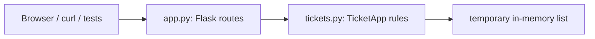

# Flask API server plan

Build the IT ticket Flask server first, using the same split between routes and ticket logic as the professor's `voting_monolith`. The routes implement `it-ticket-system-specs/openapi.yaml` exactly. No database is designed or built now; tickets live in a plain in-memory list loaded from sample data, so the server runs and can be tested. HTML/CSS templates come in a later phase.

## Tasks

- [x] Create the `src/tickets` package, remove the hyphenated placeholders, and fill in `setup.py` and `requirements.txt`
- [x] Write `TicketApp` in `tickets.py`: validation, defaults, opening note, sorting, exceptions, and a temporary in-memory ticket list seeded from `data/sample_data.json`
- [x] Write `app.py` with `create_app` / `launch`, the 6 API routes, and the shared `_error` helper
- [x] Add pytest API and logic tests using the Flask test client
- [x] Phase 2: port the mockup into Jinja templates (`base.html`, `index.html`, `submit.html`, `queue.html`, `ticket.html`) plus `static/styles.css` and `static/app.js`, and add the page routes
- [x] Phase 2: wire the pages to the API with `fetch()` and add light CSS-only animation

## Scope

- **In scope:** the Flask server, all six API routes from `it-ticket-system-specs/openapi.yaml`, the ticket rules, and tests.
- **Read-only references:** `voting_monolith` and `voting-specs-example-` are never modified. All work happens in `it-ticket-system-monolith`.
- **Deployment target (later):** an EC2 instance. Keep the app EC2-friendly by having `launch()` return the Flask app so gunicorn can serve it, by reading settings from environment variables instead of hardcoding them, and by keeping `/health` for checks. The DevOps setup itself is not part of this plan.
- **Out of scope for now:** any database design or build. That includes SQL, `db.py`, a storage interface, and schema decisions. HTML/CSS pages are also deferred to the next phase.

## The approach: two thin layers

- **Routes (`app.py`)** handle HTTP only. They parse JSON or query parameters, call one `TicketApp` method, turn the result into JSON, and map exceptions to status codes. They contain no business rules. This matches `voting_monolith/src/voting/app.py`.
- **Logic (`tickets.py`)** holds all the rules from the spec: trimming, length limits, email shape, enum checks, Medium as the default priority, the opening "System" note, queue ordering, and `updatedAt`. It raises `ValidationError` and `NotFoundError`, like `voting_monolith/src/voting/voting.py`.
- **Temporary data:** `TicketApp` keeps tickets in a plain Python list, loaded from [data/sample_data.json](../data/sample_data.json) at startup. That file is empty right now, so first copy in the contents of `it-ticket-system-specs/sample-data.json`. Data resets on every restart. This is a placeholder, not a storage design. When the database work starts later, only the internals of `TicketApp` change; the routes stay the same.

**`created_at` / `updated_at` decision (agreed with the database side):** both are stored on the ticket. On create, both are set to the same time. A status save sets `updated_at` to the current time. Adding a note changes neither. The API reads both values as-is.

## Package layout

Python cannot import a module with a hyphen in its name, so the placeholder `src/it-ticket-system.py` cannot be imported. Use a package instead, the way voting uses `src/voting/`:

- `src/tickets/__init__.py`
- `src/tickets/app.py`: `create_app(ticket_app)` and `launch()`
- `src/tickets/tickets.py`: the `TicketApp` class and its exceptions
- `src/tickets/templates/` and `src/tickets/static/`: empty for now, used in the HTML/CSS phase

Delete the placeholder files `src/app.py` and `src/it-ticket-system.py`. Leave `src/db.py` alone for the database phase. Fill in `setup.py` and `requirements.txt` (Flask, pytest).

## API routes, taken directly from openapi.yaml

- `GET /health` returns `{"status":"ok"}` with 200.
- `GET /tickets?status=&priority=` returns `{"tickets":[TicketSummary...]}`, ordered Urgent, High, Medium, Low, then newest first. An invalid filter value returns 400.
- `POST /tickets` takes a JSON body and returns 201 with `{"id":"HD-1048"}`, or 400 if validation fails. The next id is one higher than the highest existing number.
- `GET /tickets/<ticket_id>` returns the full ticket with its notes, oldest first, or 404 with code `TICKET_NOT_FOUND`.
- `PATCH /tickets/<ticket_id>` takes `{"status": ...}` and returns the full ticket, or 400 or 404.
- `POST /tickets/<ticket_id>/notes` takes `{"body": ...}` and returns 201 with the note (author is "IT staff"), or 400 or 404.

Every error response uses the spec's shape: `{"error":{"code":"BAD_REQUEST|TICKET_NOT_FOUND","message":"..."}}`. One `_error()` helper keeps that consistent. The 503 `SERVICE_UNAVAILABLE` responses are added in the database phase, since nothing can be "down" yet.

The page routes (`/`, `/submit`, `/queue`, `/ticket?id=...`) are added in the HTML phase. They will only call `render_template`, and the pages will use `fetch()` against the routes above, the same way the voting templates work.

## Tests (pytest with the Flask test client)

- `tests/test_api.py` covers each route's success, 400, and 404 cases. Each test gets a fresh `TicketApp`, so tests don't affect each other.
- `tests/test_tickets.py` covers the validation rules, default priority, the opening note, and queue ordering.

## Phase 2: HTML and CSS front end

This starts right after the API is working. The pages are ported from the mockup in `it-ticket-system-specs/ui/`, keeping its look: the blue header, cards, and priority and status badges.

- **Templates:** `src/tickets/templates/base.html` holds the shared header, nav, and footer. `index.html`, `submit.html`, `queue.html`, and `ticket.html` extend it, so the nav only lives in one place.
- **Page routes in `app.py`:** `/`, `/submit`, `/queue`, and `/ticket?id=HD-1042`. Each one only calls `render_template`. The detail page can't be reached without an id, so it is reached from the queue rather than the nav.
- **Static files:** `static/styles.css` is the mockup stylesheet. `static/app.js` holds small shared helpers: date formatting, badge class names, and error display.
- **How the pages get data:** each page uses `fetch()` against the JSON API with relative URLs such as `/tickets`, the same way the voting templates work.
  - Submit page: `POST /tickets`, then go to `/ticket?id=<new id>`. Show the API's 400 message inline.
  - Queue page: `GET /tickets`, with status and priority dropdowns that re-fetch with query parameters. Show an empty state when no tickets match.
  - Detail page: `GET /tickets/<id>`. "Save changes" sends `PATCH` with the status (even if unchanged, which refreshes `updatedAt`). "Add Note" sends `POST .../notes` and reloads the ticket. "Cancel changes" returns to the queue. A bad id shows "Ticket not found" with a link back to the queue.
- **Mockup fixes:** add "Other" to the submit page's category list (the spec requires it). Add the filter dropdowns the stylesheet already has styles for. Remove the "static mockup" wording.
- **Animation, kept light:** CSS only, with no JavaScript animation libraries and no build step. That means a short fade-in when page content loads, hover and focus transitions on buttons, nav links, and table rows, and a disabled "Saving..." state on buttons while a request runs. Everything is turned off for users who set `prefers-reduced-motion`. Nothing depends on timing, so swapping in AWS pieces later won't affect the pages.
- **Tests:** add page-route tests checking that each page returns 200.

## Run locally

`pip install -e .` then `python -m tickets.app`, which serves on port 5000. Check it with curl, for example `curl localhost:5000/tickets`.
